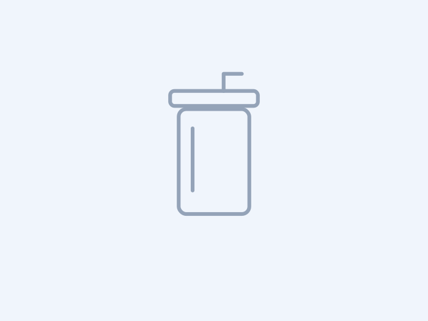

# ATLOF Frontend

Dokumentasi class CSS dan ID HTML untuk project **ATLOF (Atma Lost & Found)**.

Dokumen ini memakai nama class dan ID yang **sudah ada**. Tidak ada rename pada project.

Dokumen ini mencakup seluruh class dan ID yang ditemukan di 13 halaman `.xhtml`, `css/style.css`, dan string HTML di `js/app.js`, termasuk nama yang dibuat secara dinamis.

## Daftar isi

1. [Ringkasan](#1-ringkasan)
2. [Struktur file](#2-struktur-file)
3. [Cara menjalankan](#3-cara-menjalankan)
4. [Aturan penamaan yang dipakai](#4-aturan-penamaan-yang-dipakai)
5. [Referensi class CSS](#5-referensi-class-css)
6. [Referensi ID per halaman](#6-referensi-id-per-halaman)
7. [ID yang dibuat JavaScript](#7-id-yang-dibuat-javascript)
8. [Contoh kombinasi class](#8-contoh-kombinasi-class)
9. [Catatan penting](#9-catatan-penting)
10. [Perawatan CSS](#10-perawatan-css)

## 1. Ringkasan

- Frontend statis berbasis XHTML 1.0 Strict.
- Styling ada di `css/style.css`.
- Logika halaman ada di `js/app.js`.
- Data akun dan laporan disimpan di `localStorage` dan `sessionStorage` untuk simulasi.
- Halaman terdiri dari 11 file `.xhtml`.

## 2. Struktur file

```text
ATLOF_Frontend_Revisi_5/
├── index.xhtml
├── katalog.xhtml
├── buat_laporan.xhtml
├── edit_laporan.xhtml
├── laporan_saya.xhtml
├── detail.xhtml
├── login.xhtml
├── pendaftaran.xhtml
├── profil.xhtml
├── admin_cs.xhtml
├── akses_akun.xhtml
├── css/
│   └── style.css
├── js/
│   └── app.js
├── fonts/
│   ├── IBMPlexSans-latin.woff2
│   ├── IBMPlexMono-400-latin.woff2
│   └── IBMPlexMono-600-latin.woff2
└── images/
```

Folder `images/` berisi aset gambar dan ikon, termasuk `logo-atlof-ikon.svg` yang dipakai sebagai logo di header.

## 3. Cara menjalankan

1. Letakkan folder project di `xampp/htdocs`.
2. Jalankan Apache dari XAMPP.
3. Buka `http://localhost/ATLOF_Frontend_Revisi_5/index.xhtml`.

Project juga bisa dibuka langsung lewat browser, tetapi beberapa browser membatasi `sessionStorage` dan `localStorage` pada protokol `file://`. Cara paling aman adalah lewat Apache.

## 4. Aturan penamaan yang dipakai

- **Class** dipakai untuk styling dan penanda struktur.
- **ID** dipakai sebagai hook JavaScript, target `label for`, dan penanda elemen unik.
- Sebagian class dan ID dibuat langsung oleh `js/app.js`, bukan ditulis di file `.xhtml`.
- Prefix yang sudah dipakai:
  - `halaman-` untuk scope halaman.
  - `tombol-` untuk varian tombol.
  - `kartu-` untuk kartu.
  - `baris-` untuk baris layout.
  - `panel-` untuk panel.
  - `footer-` untuk bagian footer.
  - `admin-` dan `cs` untuk Dasbor Admin CS.
- ID harus unik dalam satu halaman. ID yang sama boleh muncul di halaman berbeda.

## 5. Referensi class CSS

### 5.1 Class global dan layout

| Class | Fungsi | Dipakai di |
| --- | --- | --- |
| `container` | Pembungkus konten dengan lebar maksimum 1280px | Semua halaman |
| `bagian` | Memberi padding atas dan bawah pada isi halaman | `admin_cs`, `buat_laporan`, `detail`, `edit_laporan`, `index`, `katalog`, `laporan_saya`, `profil` |
| `subjudul` | Teks pengantar abu-abu di bawah judul | `admin_cs`, `buat_laporan`, `edit_laporan`, `katalog`, `laporan_saya`, `login`, `pendaftaran` |
| `teks-abu` | Teks sekunder berwarna abu-abu | `admin_cs`, `detail`, `index`, `katalog` |
| `teks-emas` | Teks aksen emas | 11 halaman; `pendaftaran` dan `profil` memakai `footer-pesan` |
| `label-kecil` | Label kecil huruf kapital di atas judul | `admin_cs`, `login`, `pendaftaran` |
| `link-kembali` | Tautan kembali ke halaman sebelumnya | `akses_akun`, `detail` |
| `judul-bagian` | Baris judul dan tombol aksi di atas konten | `admin_cs`, `index`, `katalog`, `laporan_saya` |
| `judul-terpusat` | Judul dan deskripsi rata tengah | `index` |
| `pengantar` | Blok pengantar halaman | `buat_laporan`, `edit_laporan`, `katalog` |
| `form-besar` | Kartu form lebar | `buat_laporan`, `edit_laporan`, `profil` |
| `grid-barang` | Grid kartu barang | `index`, `katalog`, `laporan_saya` |
| `grid-katalog` | Grid kartu khusus halaman katalog | `katalog` |
| `layout-katalog` | Grid dua kolom: panel filter dan daftar barang | `katalog` |
| `statistik` | Baris ringkasan angka laporan | `laporan_saya` |
| `kosong` | Kotak keadaan kosong | `admin_cs`, `katalog`, `laporan_saya` |
| `katalog-page` | Penanda halaman katalog; belum punya aturan CSS | `katalog` |

### 5.2 Header dan navigasi

| Class | Fungsi | Dipakai di |
| --- | --- | --- |
| `header-utama` | Header biru yang menempel di atas saat scroll | Semua halaman |
| `navbar` | Baris navigasi utama | Semua halaman |
| `logo` | Blok merek ATLOF berisi ikon SVG dan teks | Semua halaman |
| `menu-links` | Menu navigasi utama | Semua halaman |
| `menu-akun` | Area tombol akun di kanan header | Semua halaman |
| `aktif` | Menandai link navigasi yang sedang dibuka | `buat_laporan`, `detail`, `edit_laporan`, `index`, `katalog`, `laporan_saya`, dan link Dasbor CS yang dibuat JavaScript |
| `tombol-keluar` | Varian tombol keluar di header | Dibuat JavaScript setelah login |

### 5.3 Tombol dan baris aksi

| Class | Fungsi | Dipakai di |
| --- | --- | --- |
| `tombol` | Class dasar semua tombol | Semua halaman |
| `tombol-kuning` | Tombol utama berwarna kuning | Semua halaman |
| `tombol-outline` | Tombol sekunder bergaris | Semua halaman |
| `tombol-putih` | Tombol putih untuk latar gelap | `index` |
| `tombol-kecil` | Tombol ukuran kecil | Semua halaman |
| `tombol-bahaya` | Tombol untuk aksi berbahaya seperti hapus | `profil` dan tombol Hapus yang dibuat `app.js` |
| `tombol-kalender` | Tombol pembuka kalender | `buat_laporan`, `edit_laporan` |
| `lebar-penuh` | Membuat tombol atau tautan selebar container | `katalog`, `login`, `pendaftaran` |
| `aksi` | Baris berisi beberapa tombol | `akses_akun`, `buat_laporan`, `edit_laporan`, `index`, `profil` |
| `aksi-form` | Baris aksi di bagian bawah form | `buat_laporan`, `edit_laporan` |
| `aksi-tengah` | Baris aksi rata tengah | `akses_akun` |
| `aksi-kelola` | Baris tombol Edit dan Hapus pada kartu laporan | Dibuat `app.js` di `laporan_saya` |
| `batal-profil` | Penanda tombol Batal pada form profil; belum punya aturan CSS | `profil` |
| `lihat-password` | Hook checkbox untuk menampilkan password; belum punya aturan CSS | `login`, `pendaftaran` |

### 5.4 Beranda

| Class | Fungsi | Dipakai di |
| --- | --- | --- |
| `hero` | Bagian pembuka berwarna biru | `index` |
| `hero-isi` | Isi teks dan tombol di dalam hero | `index` |
| `bagian-cara` | Seksi penjelasan cara kerja ATLOF | `index` |
| `bagian-terbaru` | Seksi laporan barang terbaru | `index` |
| `tiga-langkah` | Grid tiga langkah | `index` |
| `kartu-langkah` | Kartu satu langkah | `index` |
| `nomor-langkah` | Nomor urut langkah | `index` |

### 5.5 Katalog

| Class | Fungsi | Dipakai di |
| --- | --- | --- |
| `pencarian` | Kotak form pencarian | `katalog` |
| `baris-pencarian` | Baris input pencarian dan tombol cari | `katalog` |
| `panel-filter` | Panel filter yang menempel saat scroll | `katalog` |
| `daftar-barang` | Pembungkus daftar hasil pencarian; belum punya aturan CSS | `katalog` |
| `field` | Grup label dan input pada filter | `katalog` |

### 5.6 Form dan input

| Class | Fungsi | Dipakai di |
| --- | --- | --- |
| `halaman-form` | Scope halaman form buat dan edit laporan | `buat_laporan`, `edit_laporan` |
| `field` | Grup label, input, dan teks bantuan | `buat_laporan`, `edit_laporan`, `katalog`, `login`, `pendaftaran`, `profil` |
| `dua-kolom` | Grid dua kolom untuk field | `buat_laporan`, `edit_laporan` |
| `pilih-jenis` | Grup radio untuk jenis laporan | `buat_laporan`, `edit_laporan` |
| `judul-form` | Judul di dalam kartu form | `buat_laporan`, `edit_laporan` |
| `bantuan` | Teks bantuan kecil di bawah input | `buat_laporan`, `detail`, `edit_laporan`, `login`, `profil` |
| `bantuan-penting` | Teks bantuan yang diberi garis peringatan | `buat_laporan`, `edit_laporan` |
| `centang` | Label untuk checkbox | `login`, `pendaftaran` |
| `panel-form` | Panel form yang bisa dibuka dan ditutup | `profil` |
| `catatan` | Kotak catatan verifikasi barang | `detail` |

### 5.7 Kalender

| Class | Fungsi | Dipakai di |
| --- | --- | --- |
| `tanggal-pilih` | Pembungkus input tanggal dan tombol kalender | `buat_laporan`, `edit_laporan` |
| `kalender` | Panel kalender yang muncul di bawah input | `buat_laporan`, `edit_laporan` |
| `kalender-atas` | Header kalender berisi tombol bulan dan nama bulan | `buat_laporan`, `edit_laporan` |
| `kalender-grid` | Grid tujuh kolom untuk tanggal | `buat_laporan`, `edit_laporan` |
| `nama-hari` | Label nama hari di kalender | Dibuat `app.js` |
| `pilih-hari` | Tombol satu tanggal di kalender | Dibuat `app.js` |
| `tanggal-kosong` | Sel kosong sebelum tanggal pertama; belum punya aturan CSS | Dibuat `app.js` |

### 5.8 Kartu barang

| Class | Fungsi | Dipakai di |
| --- | --- | --- |
| `kartu-barang` | Kartu satu barang | Dibuat `app.js` untuk beranda, katalog, dan laporan saya |
| `gambar-barang` | Tautan pembungkus gambar barang | Dibuat `app.js` |
| `isi-kartu` | Bagian teks di dalam kartu barang | Dibuat `app.js` |
| `lencana-baris` | Baris berisi lencana jenis dan status | `detail` dan dibuat `app.js` |
| `lencana` | Lencana kecil untuk jenis atau status | `detail` dan dibuat `app.js` |
| `hilang` | Modifier lencana untuk laporan hilang | Dibuat `app.js` melalui `class="lencana ' + b.jenis + '"` |
| `ditemukan` | Modifier lencana untuk laporan ditemukan | Dibuat `app.js` melalui `class="lencana ' + b.jenis + '"` |
| `kartu-kelola` | Kartu laporan di halaman Laporan Saya | Dibuat `app.js` |
| `pengaturan-status` | Panel dropdown dan tombol simpan status | Dibuat `app.js` |
| `catatan-status` | Catatan bahwa status dikelola CS | Dibuat `app.js` |

### 5.9 Detail barang

| Class | Fungsi | Dipakai di |
| --- | --- | --- |
| `detail-grid` | Grid dua kolom: foto dan informasi barang | `detail` |
| `foto-detail` | Kartu pembungkus foto barang | `detail` |
| `kotak-detail` | Kartu informasi detail barang | `detail` |
| `tabel-detail` | Tabel spesifikasi barang | `detail` |
| `kontak-detail` | Blok kontak pelapor atau CS | `detail` |
| `kontak-whatsapp` | Kotak kontak WhatsApp | `detail` |
| `catatan` | Catatan verifikasi kepemilikan | `detail` |

### 5.10 Profil

| Class | Fungsi | Dipakai di |
| --- | --- | --- |
| `halaman-profil` | Scope halaman profil | `profil` |
| `profil-container` | Pembungkus konten profil | `profil` |
| `profil-atas-judul` | Judul halaman profil | `profil` |
| `profil-kartu` | Kartu utama profil | `profil` |
| `profil-atas` | Header kartu berisi avatar dan nama | `profil` |
| `avatar` | Lingkaran inisial pengguna | `profil` |
| `profil-identitas` | Grid data identitas | `profil` |
| `detail-identitas` | Satu baris data identitas | `profil` |
| `label-peran` | Lencana peran Admin CS | `profil` |
| `profil-tombol` | Pembungkus tombol profil; belum punya aturan CSS | `profil` |
| `tombol-bahaya` | Tombol Keluar berwarna merah | `profil` |

### 5.11 Autentikasi

| Class | Fungsi | Dipakai di |
| --- | --- | --- |
| `grid-akun` | Grid dua kolom: panel informasi dan kartu form | `login`, `pendaftaran` |
| `panel-samping` | Panel informasi berwarna biru di kiri | `login`, `pendaftaran` |
| `kotak-form` | Kartu form autentikasi | `login`, `pendaftaran` |
| `halaman-akses` | Scope halaman persyaratan akses | `akses_akun` |
| `kotak-akses` | Kartu ajakan masuk atau daftar | `akses_akun` |
| `aksi-tengah` | Baris tombol rata tengah | `akses_akun` |

### 5.12 Dasbor Admin CS

| Class | Fungsi | Dipakai di |
| --- | --- | --- |
| `halaman-admin` | Scope halaman Dasbor Admin CS | `admin_cs` |
| `ringkasan-admin` | Grid empat kartu ringkasan | `admin_cs` |
| `angka-admin` | Satu kartu angka ringkasan | `admin_cs` |
| `panel-admin` | Panel judul dan kontak CS | `admin_cs` |
| `baris-kontak-cs` | Baris nomor WhatsApp layanan CS | `admin_cs` |
| `daftar-admin` | Wadah daftar barang titipan | `admin_cs` |
| `baris-admin` | Satu baris barang titipan | Dibuat `app.js` |
| `info-admin` | Bagian foto dan info barang | Dibuat `app.js` |
| `kontrol-admin` | Dropdown dan tombol status penanganan | Dibuat `app.js` |

### 5.13 Footer

| Class | Fungsi | Dipakai di |
| --- | --- | --- |
| `footer-utama` | Footer biru tua | Semua halaman |
| `footer-isi` | Grid isi footer | Semua halaman |
| `footer-tentang` | Kolom tentang ATLOF; belum punya aturan CSS | Semua halaman |
| `footer-merk` | Blok merek di footer | Semua halaman |
| `footer-menu` | Kolom menu footer | Semua halaman |
| `footer-kampus` | Kolom informasi kampus | Semua halaman |
| `footer-bawah` | Baris copyright di dasar footer | Semua halaman |
| `footer-pesan` | Slogan footer berwarna emas | `pendaftaran`, `profil` |

### 5.14 Notifikasi dan status

| Class | Fungsi | Dipakai di |
| --- | --- | --- |
| `pesan-form` | Kotak notifikasi global di kanan bawah | Dibuat `app.js` melalui `pesan()` |
| `gagal` | Modifier merah untuk notifikasi gagal | Dibuat `app.js` melalui `pesan()` |

### 5.15 Class yang dibuat JavaScript

Tabel ini merangkum class yang tidak selalu terlihat di file `.xhtml`.

| Class | Dibuat oleh | Fungsi |
| --- | --- | --- |
| `kartu-barang` | `buatKartu()` | Kartu barang |
| `gambar-barang` | `buatKartu()` | Tautan gambar barang |
| `isi-kartu` | `buatKartu()` | Isi teks kartu |
| `lencana-baris` | `buatKartu()` | Baris lencana |
| `lencana` | `buatKartu()`, `tampilkanDashboardCS()` | Lencana status |
| `hilang` | `buatKartu()` | Modifier lencana jenis hilang |
| `ditemukan` | `buatKartu()` | Modifier lencana jenis ditemukan |
| `kartu-kelola` | `perbaruiLaporanSaya()` | Kartu laporan di Laporan Saya |
| `aksi-kelola` | `perbaruiLaporanSaya()` | Tombol Edit dan Hapus |
| `pengaturan-status` | `perbaruiLaporanSaya()` | Panel ubah status |
| `catatan-status` | `perbaruiLaporanSaya()` | Catatan status CS |
| `baris-admin` | `tampilkanDashboardCS()` | Baris barang titipan |
| `info-admin` | `tampilkanDashboardCS()` | Info barang titipan |
| `kontrol-admin` | `tampilkanDashboardCS()` | Kontrol status barang |
| `nama-hari` | `pasangKalender()` | Label hari kalender |
| `pilih-hari` | `pasangKalender()` | Tombol tanggal kalender |
| `tanggal-kosong` | `pasangKalender()` | Sel kosong kalender |
| `pesan-form` | `pesan()` | Notifikasi global |
| `gagal` | `pesan()` | Modifier notifikasi gagal |
| `tombol-keluar` | Header setelah login | Tombol keluar |
| `aktif` | Header admin | Menandai link Dasbor CS |

## 6. Referensi ID per halaman

Semua halaman memiliki `#menu-akun` di header. ID tersebut dipakai `app.js` untuk mengganti tombol Masuk/Daftar menjadi Profil/Keluar setelah login.

### 6.1 `index.xhtml`

| ID | Fungsi |
| --- | --- |
| `menu-akun` | Wadah tombol akun di header |
| `aksi-beranda-tamu` | Blok tombol untuk pengunjung |
| `aksi-beranda-masuk` | Blok tombol untuk pengguna yang sudah masuk |
| `bagian-cara` | Seksi cara kerja ATLOF |
| `bagian-terbaru` | Seksi laporan terbaru |
| `barang-terbaru` | Grid laporan terbaru |

### 6.2 `katalog.xhtml`

| ID | Fungsi |
| --- | --- |
| `menu-akun` | Wadah tombol akun di header |
| `form-cari` | Form pencarian barang |
| `cari` | Input kata kunci; target `label for` |
| `filter-jenis` | Dropdown jenis laporan |
| `filter-kategori` | Dropdown kategori |
| `filter-lokasi` | Dropdown lokasi kampus |
| `filter-status` | Dropdown status barang |
| `tombol-filter` | Tombol terapkan filter |
| `tombol-reset` | Tombol bersihkan filter |
| `jumlah-barang` | Teks jumlah hasil pencarian |
| `semua-barang` | Grid semua hasil laporan |
| `tidak-ada` | Pesan saat tidak ada hasil |

### 6.3 `buat_laporan.xhtml`

| ID | Fungsi |
| --- | --- |
| `menu-akun` | Wadah tombol akun di header |
| `form-laporan` | Form buat laporan |
| `nama-barang` | Input nama barang |
| `kategori` | Dropdown kategori |
| `tanggal` | Input tanggal kejadian, readonly |
| `label-lokasi` | Label lokasi yang berubah sesuai jenis laporan |
| `lokasi` | Dropdown lokasi kampus |
| `wadah-detail-lokasi` | Grup keterangan lokasi lainnya |
| `detail-lokasi` | Input keterangan lokasi lainnya |
| `wadah-penyimpanan` | Grup lokasi penyimpanan barang |
| `penyimpanan` | Dropdown lokasi penyimpanan |
| `deskripsi` | Textarea deskripsi barang |
| `foto` | Input file foto barang |
| `telepon` | Input nomor WhatsApp alternatif |
| `bantuan-telepon` | Teks bantuan nomor WhatsApp |
| `buka-kalender` | Tombol membuka kalender |
| `kotak-kalender` | Panel kalender |
| `bulan-sebelum` | Tombol bulan sebelumnya |
| `bulan-berikut` | Tombol bulan berikutnya |
| `nama-bulan` | Label bulan dan tahun |
| `hari-kalender` | Grid tanggal kalender |

### 6.4 `edit_laporan.xhtml`

ID di halaman ini sama dengan `buat_laporan.xhtml`, kecuali form utama memakai `form-edit`.

| ID | Fungsi |
| --- | --- |
| `menu-akun` | Wadah tombol akun di header |
| `form-edit` | Form edit laporan |
| `nama-barang` | Input nama barang |
| `kategori` | Dropdown kategori |
| `tanggal` | Input tanggal kejadian, readonly |
| `label-lokasi` | Label lokasi yang berubah sesuai jenis laporan |
| `lokasi` | Dropdown lokasi kampus |
| `wadah-detail-lokasi` | Grup keterangan lokasi lainnya |
| `detail-lokasi` | Input keterangan lokasi lainnya |
| `wadah-penyimpanan` | Grup lokasi penyimpanan barang |
| `penyimpanan` | Dropdown lokasi penyimpanan |
| `deskripsi` | Textarea deskripsi barang |
| `foto` | Input file foto barang |
| `telepon` | Input nomor WhatsApp alternatif |
| `bantuan-telepon` | Teks bantuan nomor WhatsApp |
| `buka-kalender` | Tombol membuka kalender |
| `kotak-kalender` | Panel kalender |
| `bulan-sebelum` | Tombol bulan sebelumnya |
| `bulan-berikut` | Tombol bulan berikutnya |
| `nama-bulan` | Label bulan dan tahun |
| `hari-kalender` | Grid tanggal kalender |

### 6.5 `laporan_saya.xhtml`

| ID | Fungsi |
| --- | --- |
| `menu-akun` | Wadah tombol akun di header |
| `total-saya` | Jumlah total laporan pengguna |
| `jumlah-hilang` | Jumlah laporan barang hilang |
| `jumlah-ditemukan` | Jumlah laporan barang ditemukan |
| `barang-saya` | Grid laporan milik pengguna |
| `kosong-saya` | Keadaan kosong saat belum ada laporan |
| `status-<id>` | Dropdown status per laporan, dibuat `app.js` |
| `kelola-<id>` | Pembungkus kartu per laporan, dibuat `app.js` |

### 6.6 `detail.xhtml`

| ID | Fungsi |
| --- | --- |
| `menu-akun` | Wadah tombol akun di header |
| `detail-foto` | Gambar barang |
| `detail-nama` | Nama barang |
| `detail-jenis` | Jenis laporan: hilang atau ditemukan |
| `detail-status` | Status barang |
| `detail-pelapor` | Nama pelapor |
| `detail-kategori` | Kategori barang |
| `detail-lokasi` | Lokasi kampus barang |
| `detail-tanggal` | Tanggal kejadian |
| `detail-simpan` | Lokasi penyimpanan barang |
| `detail-deskripsi` | Deskripsi barang |
| `detail-info-kontak` | Keterangan cara menghubungi |
| `detail-teams` | Tautan Microsoft Teams |
| `detail-whatsapp` | Kotak kontak WhatsApp |
| `detail-nomor` | Nomor WhatsApp yang ditampilkan |
| `detail-whatsapp-link` | Tautan WhatsApp |

### 6.7 `login.xhtml`

| ID | Fungsi |
| --- | --- |
| `menu-akun` | Wadah tombol akun di header |
| `form-login` | Form masuk |
| `email` | Input email |
| `password` | Input password |
| `link-daftar` | Tautan ke halaman pendaftaran |

### 6.8 `pendaftaran.xhtml`

| ID | Fungsi |
| --- | --- |
| `menu-akun` | Wadah tombol akun di header |
| `form-daftar` | Form pendaftaran akun |
| `nama` | Input nama lengkap |
| `email` | Input email |
| `teams` | Input kontak Microsoft Teams |
| `password` | Input password |
| `konfirmasi` | Input konfirmasi password |
| `link-login` | Tautan ke halaman masuk |

### 6.9 `profil.xhtml`

| ID | Fungsi |
| --- | --- |
| `menu-akun` | Wadah tombol akun di header |
| `nama-profil` | Nama pengguna di kartu profil |
| `email-profil` | Email pengguna di kartu profil |
| `avatar-profil` | Inisial avatar pengguna |
| `label-peran-profil` | Label peran Admin CS |
| `data-profil` | Grid data identitas |
| `info-nama` | Nilai nama lengkap |
| `info-email` | Nilai email |
| `info-teams` | Nilai kontak Teams |
| `identitas-admin` | Baris lokasi pelayanan CS |
| `info-kampus-cs` | Nilai kampus CS |
| `identitas-wa` | Baris WhatsApp layanan CS |
| `info-telepon` | Nilai WhatsApp layanan CS |
| `profil-tombol` | Baris tombol profil |
| `tombol-edit-profil` | Tombol ubah profil |
| `tombol-ganti-password` | Tombol ubah password |
| `tombol-logout` | Tombol keluar |
| `form-profil` | Form edit profil |
| `nama` | Input nama lengkap |
| `email` | Input email, readonly |
| `teams` | Input kontak Teams |
| `form-nomor-cs` | Grup WhatsApp layanan CS |
| `nomor-cs` | Input WhatsApp layanan CS |
| `form-password` | Form ubah password dari profil |
| `password-lama` | Input password sekarang |
| `password-baru` | Input password baru |
| `konfirmasi-password` | Input konfirmasi password baru |

### 6.10 `admin_cs.xhtml`

| ID | Fungsi |
| --- | --- |
| `menu-akun` | Wadah tombol akun di header |
| `subjudul-admin` | Subjudul dasbor sesuai kampus |
| `admin-total` | Jumlah total barang titipan |
| `admin-menunggu` | Jumlah barang menunggu diterima |
| `admin-diterima` | Jumlah barang diterima CS |
| `admin-selesai` | Jumlah barang sudah dikembalikan |
| `nomor-wa-admin` | Nomor WhatsApp layanan CS |
| `daftar-admin` | Wadah daftar barang titipan |
| `kosong-admin` | Keadaan kosong saat belum ada titipan |
| `status-cs-<id>` | Dropdown status penanganan per barang, dibuat `app.js` |

### 6.11 `akses_akun.xhtml`

| ID | Fungsi |
| --- | --- |
| `menu-akun` | Wadah tombol akun di header |
| `akses-masuk` | Tombol menuju halaman masuk |
| `akses-daftar` | Tombol menuju halaman pendaftaran |

## 7. ID yang dibuat JavaScript

| ID | Dibuat oleh | Fungsi |
| --- | --- | --- |
| `status-<id>` | `pilihanStatus()` dipanggil `perbaruiLaporanSaya()` | Dropdown status laporan pengguna |
| `status-cs-<id>` | `tampilkanDashboardCS()` | Dropdown status penanganan barang CS |
| `kelola-<id>` | `perbaruiLaporanSaya()` | Pembungkus kartu laporan di Laporan Saya |
| `pesan-global` | `pesan()` | Kotak notifikasi global |
| `keluar-header` | Header setelah login | Tombol keluar di header |

Keterangan: `<id>` adalah ID laporan. Laporan contoh memakai angka 1 sampai 10, sedangkan laporan baru memakai `Date.now()`.

## 8. Contoh kombinasi class

Tombol utama:

```html
<a class="tombol tombol-kuning tombol-kecil" href="katalog.xhtml">Lihat katalog</a>
```

Field form:

```html
<div class="field">
  <label for="nama-barang">Nama barang <em>*</em></label>
  <input id="nama-barang" name="nama-barang" type="text" />
</div>
```

Kartu barang yang dibuat `app.js`:

```html
<div class="kartu-barang">
  <a class="gambar-barang" href="detail.xhtml?id=1">
    
  </a>
  <div class="isi-kartu">
    <div class="lencana-baris">
      <span class="lencana hilang">Hilang</span>
      <span class="lencana">Masih dicari</span>
    </div>
    <h3><a href="detail.xhtml?id=1">Tumbler Hitam</a></h3>
    <p>Tumbler</p>
  </div>
</div>
```

Lencana jenis dan status:

```html
<!-- Pilih salah satu sesuai jenis laporan. -->
<span class="lencana hilang">Hilang</span>
<span class="lencana ditemukan">Ditemukan</span>
```

Notifikasi gagal yang dibuat `app.js`:

```html
<div class="pesan-form gagal">Lengkapi formulir terlebih dahulu.</div>
```

## 9. Catatan penting

- `hilang` dan `ditemukan` bukan class mandiri. Keduanya modifier untuk `lencana`, sehingga di HTML menjadi `class="lencana hilang"` atau `class="lencana ditemukan"`.
- `pesan-form` dan `gagal` juga dipakai bersama, sehingga notifikasi gagal menjadi `class="pesan-form gagal"`.
- `#detail-lokasi` punya arti berbeda di halaman berbeda:
  - Di `buat_laporan.xhtml` dan `edit_laporan.xhtml`: input keterangan lokasi lainnya.
  - Di `detail.xhtml`: sel tabel lokasi kampus.
- `#email`, `#password`, `#nama`, dan `#teams` muncul di beberapa halaman. Ini aman karena setiap halaman dimuat terpisah.
- `#menu-akun` ada di semua halaman dan isinya diganti oleh `app.js` setelah login.
- Class berikut dipakai di HTML atau dibuat JavaScript, tetapi belum punya aturan CSS:
  - `batal-profil`
  - `daftar-barang`
  - `footer-tentang`
  - `katalog-page`
  - `lihat-password`
  - `profil-tombol`
  - `tanggal-kosong`
- `teks-emas` dan `footer-pesan` sama-sama memberi warna aksen pada slogan footer, tetapi warnanya berbeda. Saat ini `pendaftaran` dan `profil` memakai `footer-pesan`, halaman lain memakai `teks-emas`.
- ID `status-<id>`, `status-cs-<id>`, dan `kelola-<id>` harus unik dalam satu halaman. Jangan memakai ID laporan yang sama dua kali.
- Jika nanti ada rename class atau ID, file yang perlu diperbarui adalah semua `.xhtml`, `css/style.css`, dan string HTML di `js/app.js`.

## 10. Perawatan CSS

`css/style.css` sudah dirapikan dari aturan yang tidak berefek pada tampilan.

### 10.1 Yang sudah dihapus

- `.footer-kampus img` dan `@media 480px .footer-kampus img`: tidak ada gambar di dalam footer kampus.
- `.footer-isi h3`: semua `h3` footer ada di dalam `.footer-merk`, dan warnanya ditentukan `.footer-merk h3`.
- `input[type="email"]`, `input[type="search"]`, `input[type="date"]`, `input[type="tel"]`: tidak ada input dengan tipe tersebut.
- `position: relative` dan `overflow: hidden` pada `.hero`.
- `position: relative` dan `z-index: 1` pada `.hero-isi`.
- `overflow: hidden` pada `.gambar-barang`; parent `.kartu-barang` sudah memotong gambar.
- Properti flex pada elemen yang hanya punya satu anak: `.footer-merk`, `.footer-bawah`, dan `.footer-kampus`.
- `.hero h1 { font-size: 34px; }` di `@media 700px`; ditimpa `.hero h1 { font-size: 35px; }` di `@media 760px`.
- `.footer-isi` di dalam `@media 700px`; sudah diatur `@media 760px`.
- `.grid-katalog` di dalam `@media 1000px` dan `@media 700px`; aturan dua kolom sudah diatur `@media 1170px`.

### 10.2 Yang sengaja dipertahankan

- `display: flex` pada `.footer-kampus` tetap ada karena memengaruhi lebar konten; yang dihapus hanya `gap` dan `align-items`.
- `.logo` kembali memakai `align-items: center` dan `gap: 10px` karena sekarang memiliki dua anak: ikon SVG dan teks.
- Logo SVG memakai `alt=""` karena teks “ATLOF” di sebelahnya sudah memberi nama yang dapat dibaca pembaca layar.
- `@media 480px .grid-katalog { grid-template-columns: 1fr; }` tetap ada karena mengembalikan katalog ke satu kolom di layar kecil setelah aturan dua kolom yang lebih lebar.
- `input[type="text"]`, `input[type="password"]`, `select`, dan `textarea` tetap dipakai.
- `overflow: hidden` pada `.kartu-barang` tetap dipakai untuk memotong gambar dan sudut kartu.

### 10.3 Breakpoint aktual

| Selector | Perilaku |
|---|---|
| `.grid-barang` | 3 kolom di atas 1000px, 2 kolom 701-1000px, 1 kolom 700px ke bawah |
| `.grid-katalog` | 3 kolom di atas 1170px, 2 kolom 481-1170px, 1 kolom 480px ke bawah |
| `.footer-isi` | 3 kolom di atas 760px, 1 kolom 760px ke bawah |
| `.hero h1` | 48px di atas 760px, 35px 760px ke bawah |
| `.hero-isi` | padding 76px 0 74px di atas 700px, 62px 0 700px ke bawah |

Ukuran ikon logo di header adalah 32px, lalu 28px pada layar 480px ke bawah.

Catatan: aturan satu kolom `.grid-katalog` di `@media 700px` dihapus karena sudah ditimpa oleh aturan dua kolom `@media 1170px`. Jangan menambahkannya kembali sebelum urutan media query diperbaiki. Perbaikan urutan media query sengaja tidak dilakukan sekarang agar tampilan dan perilaku responsif tetap sama.
